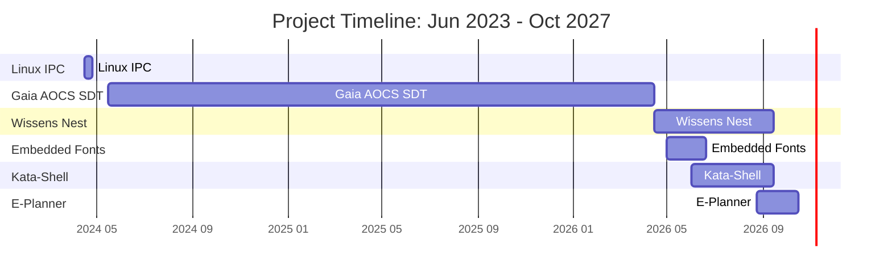

## Hello, and welcome to my GitHub profile!

I am a software developer with 25 years of experience. The consistent pattern across those years: before any architecture was possible, there was a domain to understand — track circuits and axle physics before railway data analysis, transformer calibration factors before energy billing, reliability theory from economics literature before building a measurement methodology the software industry didn't have, wave behavior models before automated trading research, quaternion mathematics and attitude control theory before spacecraft simulation.

The software was never the first thing. Understanding the domain was.

---

## Recent work

### [Gaia telescope AOCS Software Digital Twin (2024–2026)](https://github.com/K-S-K/CV/blob/main/Articles/36_GaiaSDT/Article.md)

Recently, I worked on simulating the Gaia telescope's Attitude and Orbit Control System at the Astronomisches Rechen-Institut, Heidelberg University — a research instrument the team uses to test ideas for the next-generation telescope mission.

Scientists had developed ideas for improving attitude control for the next generation of telescopes, but needed a complete simulation to test them. The existing partial implementations — Python and Java modules built independently by different researchers — had never run together. I learned the full control loop: scanning law, inertial rotation, disturbances, star tracker, Kalman filtering, micro propulsion. The hardest conceptual challenge: the controller never knows what it actually did — it fires the thrusters and watches to see whether the stars shift as expected. Getting the three-way separation between commanded torque, applied torque, and observable effect right was the foundation of the entire architecture.

**Categories:** [Job](https://github.com/K-S-K/CV/blob/main/Articles/EmploymentBasedProjects.md)

### [E-Planner — An AI-Guided Planner for Hydrogen Production Facilities (2026)](https://github.com/K-S-K/CV/blob/main/Articles/41_H2D_EPlanner/Article.md)

This autumn, I had an internship at a hydrogen-production planning firm. They let me do one AI-related task in the existing product and wrap one modeling part of their product with an AI-powered assistant.

The platform already had a solid calculator for sizing and costing for the hydrogen production facility. It was a form. You had to know which scenario to choose, which fields to fill, and what the numbers meant.

That is fine for an expert. For someone who just owns a wind farm, or runs a fleet of hydrogen trucks, or simply thinks "maybe I should make hydrogen", it is a wall. Such a user rarely knows the right question, so they cannot get the right answer.

My task was to lower this barrier to entry. The user should feel comfortable from the first click, and the product should lead them step by step to a solution to their own problem — without losing a single bit of the calculator's precision.

**Categories:** [Job](https://github.com/K-S-K/CV/blob/main/Articles/EmploymentBasedProjects.md)

### [WissensNest — Local AI Assistant (2026)](https://github.com/K-S-K/CV/blob/main/Articles/37_LocalAI/Article.md)

A personal AI assistant running entirely locally on a MacBook Pro M3. The motivation was ownership, reproducibility, and the need to control the full prompt stack for research-adjacent work. Building it produced a conceptual insight I find more useful than "it's just statistics": an LLM is a *Chemical computer* — fast, associative, pattern-driven. The surrounding framework — project system, prompt architecture, tool integration — is the *Logical computer*. The two together may be more capable than either alone. That is still a hypothesis. Testing it is part of why the project continues.

### [File Explorer for macOS (2026)](https://github.com/K-S-K/CV/blob/main/Articles/39_Shell/Article.md)

This tool helps me to feel at home on macOS after years with Windows Explorer.

I shared it as a product at [katashell.app](https://www.katashell.app/).

### [Font Rasterization Service (2026)](https://github.com/K-S-K/CV/blob/main/Articles/38_EmbeddedFonts/Article.md)

Embedded Font Generator is a SaaS that rasterizes TTF fonts into C header files for small monochrome displays — SSD1306 OLED, e-ink, ST7735. Users can pick a font, set the cell dimensions, trim the character set to what the firmware needs, manually fix any pixels, preview on an emulated display, and download a ready-to-compile .h file.

It is the currently working service **[embedded-font.com](https://embedded-font.com/)**, which can serve embedded developers right now—for free, runs in the browser, and needs no account.

### [FreeRTOS-based timer on RP2350 (2025)](https://github.com/K-S-K/Pico-Timer-2)

A hardware timer project: buttons, buzzer, 4×7-segment display, FreeRTOS task scheduling on the RP2350. The goal was hardware-level understanding — not to collect a credential, but to add embedded thinking to the software background I already have.

---

## What I want to work on

Real problems where the domain is what matters — science, instrumentation, embedded systems, critical infrastructure. Places where correct answers depend on understanding the physics or the engineering, not just the requirements.

---

*Photography (with a real camera), traveling, and more microcontrollers — these happen in the time that remains.*

The **[full project gallery](https://github.com/K-S-K/CV/blob/main/README.md#project-gallery)** covers 25 years of work across all domains.
